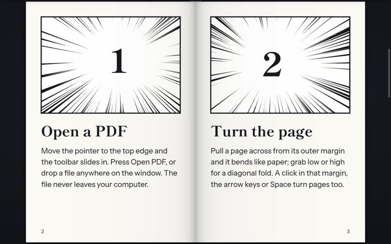
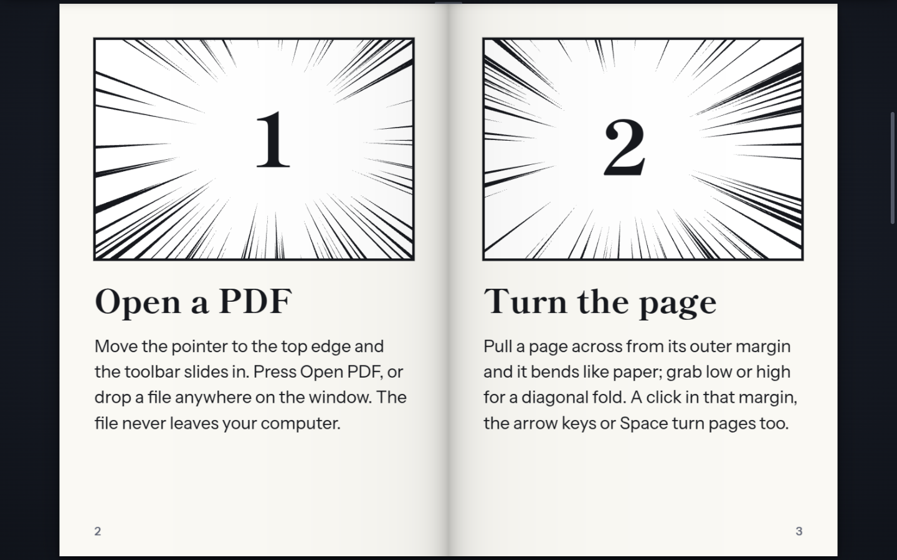
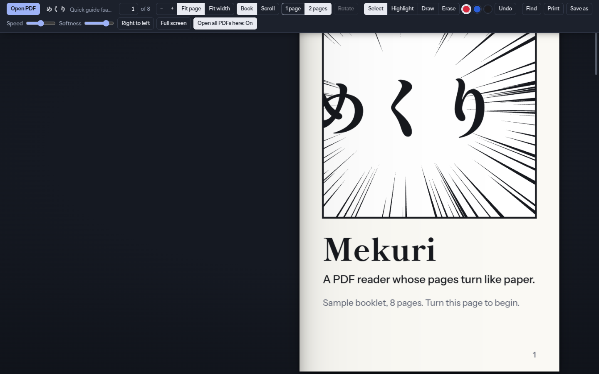
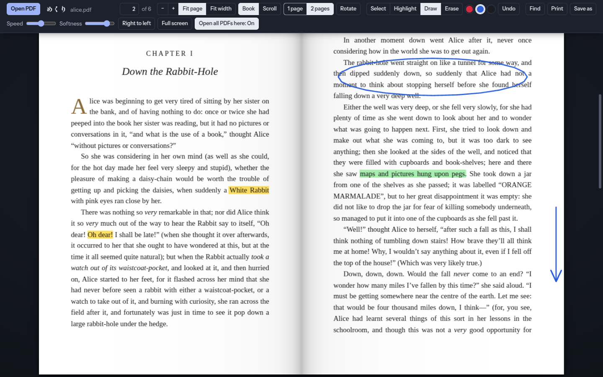
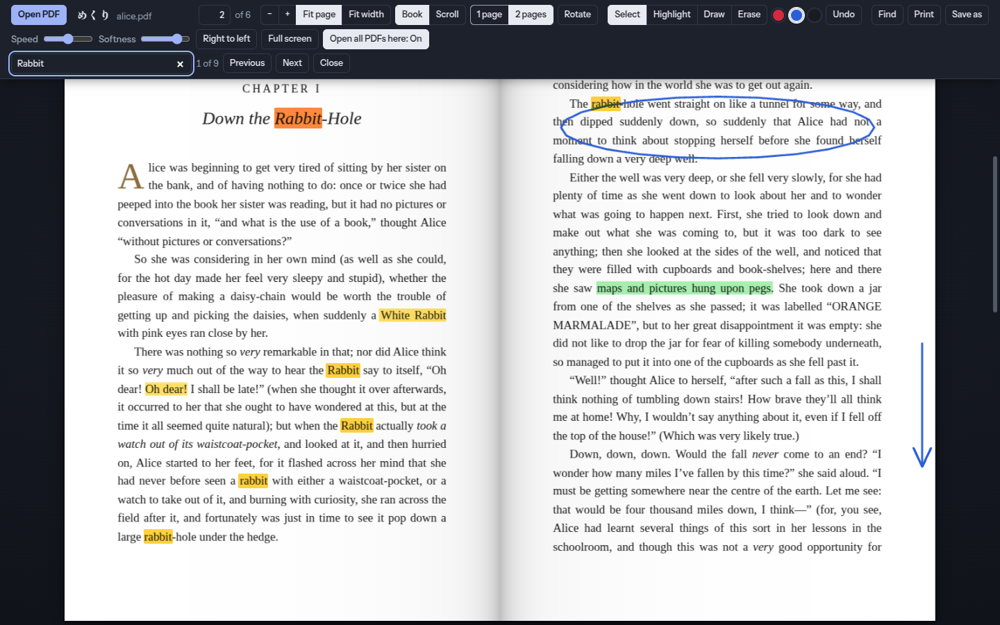
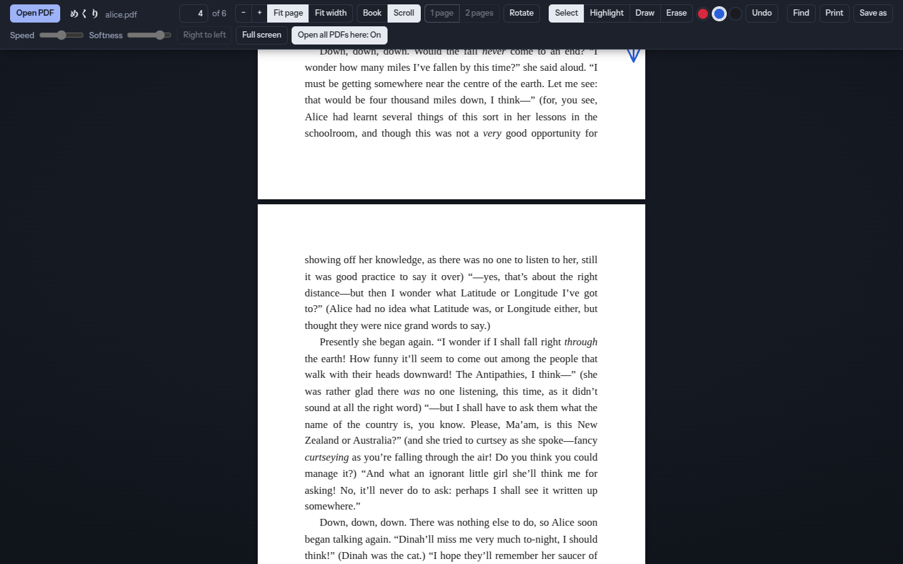

# Mekuri PDF Reader

A Chromium browser extension (Manifest V3) for reading PDFs with pages that turn like paper. *Mekuri* (めくり) is Japanese for "turning over" a page.

## Screenshots

| | |
| --- | --- |
|  **Book view**: two-page spread of the built-in sample booklet. |  **Toolbar**: slides in when the pointer reaches the top edge. |
|  **Highlight and draw** on any PDF, then save a copy with the marks. |  **Find** across the whole document. |
|  **Scroll view** for ordinary vertical reading. | |

The sample text in the screenshots is from *Alice's Adventures in Wonderland* by Lewis Carroll (public domain).

## Features

- **Book view**: drag a page corner, or click a page, to turn it. Rendered in WebGL with an adjustable curl and turn speed.
- **Scroll view**: ordinary continuous vertical scrolling.
- Single or double page layouts, right-to-left reading, zoom (fit page, fit width, custom) and quarter-turn rotation.
- Find in the document, highlighter, pen and eraser, with undo.
- **Save a copy with your marks**: highlights and drawings are written into a new PDF.
- Print.
- Optional **default viewer** mode. When it is on, every PDF opened in the browser goes to Mekuri instead of the built-in viewer.

## Install (unpacked)

1. Open `chrome://extensions` (or `edge://extensions`, `brave://extensions`).
2. Turn on **Developer mode**.
3. Click **Load unpacked** and pick this folder.

## Usage

- Click the toolbar button on a PDF tab to open that PDF in Mekuri. On any other tab it opens an empty reader.
- Right-click a link and choose **Open PDF link in Mekuri**.
- With default-viewer mode on, PDFs open in Mekuri automatically.

| Shortcut | Action |
| --- | --- |
| Ctrl+F | Find (Enter / Shift+Enter for next / previous match) |
| Ctrl+S | Save a copy with your marks |
| Ctrl+P | Print |
| Ctrl+Z | Undo the last mark |
| R | Rotate pages |
| Esc | Back to the read tool |
| Ctrl+wheel | Zoom |

## Architecture

| File | Role |
| --- | --- |
| `manifest.json` | Extension manifest (MV3). |
| `background.js` | Service worker. Handles the toolbar button and the link context menu, and does default-viewer interception (see below). |
| `reader.html` / `reader.css` | Reader page and toolbar. |
| `reader.js` | The whole reader: WebGL page-curl renderer, PDF.js page rendering into textures, book and scroll views, find, annotations, saving and preferences. |
| `pdf.min.js`, `pdf.worker.min.js`, `cmaps/`, `standard_fonts/` | Bundled [PDF.js](https://mozilla.github.io/pdf.js/) 3.11.174 (Apache-2.0, see `pdfjs-LICENSE.txt`). |
| `docs/screenshots/` | Images used in this README. Not used by the extension. |
| `pdf-lib.min.js` | Bundled [pdf-lib](https://pdf-lib.js.org/) (MIT, see `pdf-lib-LICENSE.md`), used only to write marks into a saved copy. |

### Design decisions

- **The page curl is drawn in WebGL, not CSS.** The page is a mesh. A vertex shader wraps every point past the fold line around a cylinder (radius = `CURL` × page width), and a perspective camera makes the lifted part look raised. This gives a real curl rather than a flat flip.
- **Web PDFs are detected by content type, not by URL.** `background.js` records main-frame responses with `Content-Type: application/pdf`. On navigation commit it redirects only those tabs. Local `file://` PDFs are matched by their `.pdf` ending.
- **Navigation is never hijacked.** Responses sent with `Content-Disposition: attachment` (downloads) are left alone, and so is Back/Forward navigation, so the Back button never sends you into a redirect loop.
- **Libraries are bundled.** PDF.js, its worker, cmaps and fonts ship with the extension, so it works offline and has no remote code. The CDN worker URL in `reader.js` is only a fallback for running `reader.html` outside the extension.
- **Preferences stay local.** Reader settings (layout, direction, view, zoom, curl, speed) are kept in `localStorage`. The default-viewer switch is kept in `chrome.storage.local` so the service worker can read it.

## Permissions

`activeTab`, `contextMenus`, `storage`, `webNavigation`, `webRequest` and `<all_urls>` host access. Default-viewer mode needs these to spot PDF responses on any site and fetch them with the user's cookies. Nothing is sent anywhere.

## Licence

[MIT](LICENSE). The bundled third-party libraries keep their own licences: PDF.js is Apache-2.0 and pdf-lib is MIT. See `pdfjs-LICENSE.txt`, `pdf-lib-LICENSE.md` and `standard_fonts/LICENSE_*`.
